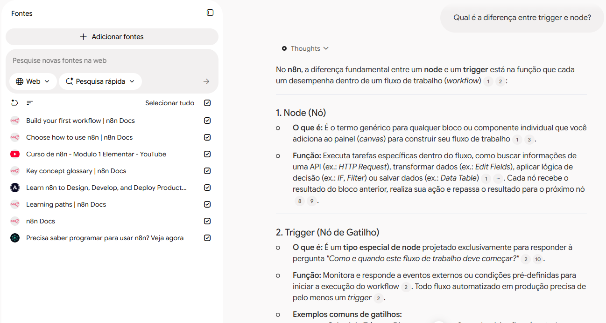
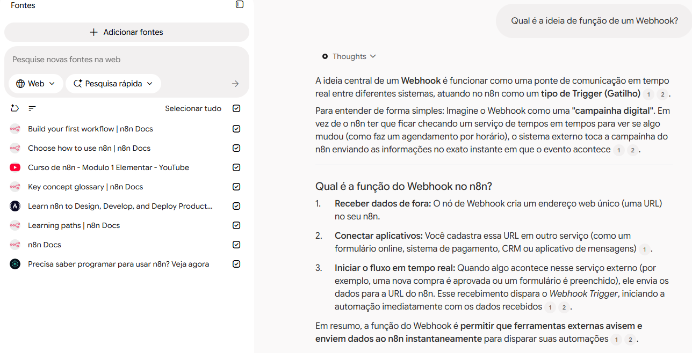

# Segundo cérebro: Introdução ao n8n
 
Notebook especialista em n8n, criado no Gemini Notebook (antigo NotebookLM), que responde apenas com base nas fontes que selecionei.
 
🔗 **Notebook compartilhado:** [Aprenda N8N](https://notebook.google.com/notebook/2a70922c-e6b9-472f-9477-50da12f8d037)
 
## Tema e objetivo
 
> Entender o que é o n8n e como funcionam seus workflows (triggers, nodes e dados), para ser capaz de montar minha primeira automação.
 
## Fontes e por que confio nelas
 
| Fonte | Formato | Por que confio |
|---|---|---|
| [n8n Docs](https://docs.n8n.io/welcome) | Documentação | Documentação oficial do n8n |
| [Build your first workflow](https://docs.n8n.io/build-your-first-workflow) | Documentação | Oficial; tutorial prático para iniciantes |
| [Key concept glossary](https://docs.n8n.io/key-concept-glossary) | Documentação | Oficial; define os termos-chave |
| [Learning paths](https://docs.n8n.io/learning-paths) | Documentação | Oficial; trilha de estudo sugerida pelo n8n |
| [Choose how to use n8n](https://docs.n8n.io/choose-how-to-use-n8n) | Documentação | Oficial; compara Cloud e self-hosted |
| [Curso n8n Elementar, Módulo 1](https://www.youtube.com/playlist?list=PLszP4qi3UlbiyyInSOYQ_cFjowQQQ0_ZJ) | Vídeo (PT-BR) | Curso gratuito divulgado na comunidade oficial do n8n; não é oficial, então usei como complemento em português |
| [Learn n8n to Design, Develop, and Deploy AI Agents](https://www.freecodecamp.org/news/learn-n8n-to-design-develop-and-deploy-production-grade-ai-agents/) | Artigo | freeCodeCamp, referência conhecida em educação técnica |
| [Precisa saber programar para usar n8n?](https://horadecodar.com.br/precisa-saber-programar-usar-n8n/) | Artigo (PT-BR) | Visão para iniciantes em português; o site também divulga cursos próprios, então usei só como apoio |
 
## Diretriz dada ao notebook
 
```
Comporte-se como um especialista em n8n que ensina iniciantes. Responda somente com base nas fontes do notebook, explique os termos técnicos de forma simples e, se a informação não estiver nas fontes, diga que não encontrou.
```
 
## Perguntas e respostas
 
### 1. Qual a diferença entre node e trigger no n8n?
 
**Resumo da resposta:** o *node* é qualquer bloco do workflow que executa uma tarefa (buscar dados de uma API, transformar dados, aplicar lógica de decisão) e repassa o resultado ao próximo. O *trigger* é um tipo especial de node que define como e quando o workflow começa, e todo fluxo automatizado em produção precisa de pelo menos um.



**Fontes citadas:** 
- Key concept glossary | n8n Docs
- Build your first workflow | n8n Docs
- Curso de n8n - Modulo 1 Elementar - YouTube


### 2. Qual é a ideia de função de um Webhook?
 
**Resumo da resposta:** A ideia central de um Webhook é funcionar como uma ponte de comunicação em tempo real entre diferentes sistemas, atuando no n8n como um tipo de Trigger (Gatilho)
.
Para entender de forma simples: Imagine o Webhook como uma "campainha digital". Em vez de o n8n ter que ficar checando um serviço de tempos em tempos para ver se algo mudou (como faz um agendamento por horário), o sistema externo toca a campainha do n8n enviando as informações no exato instante em que o evento acontece.
 


**Fontes citadas:** 
- Curso de n8n - Modulo 1 Elementar - YouTube   
 
## Materiais gerados no Estúdio
 
- [Mapa mental dos tipos mais comuns de Nodes do N8N]("materiais/mapa-mental-nodes.png")
- [Flash Cards para estudo em formato CSV](materiais/flashcards.csv)
## Estrutura do repositório
 
```
├── README.md
├── materiais/   # mapa mental e slides
└── prints/      # prints do chat com as citações
```
 